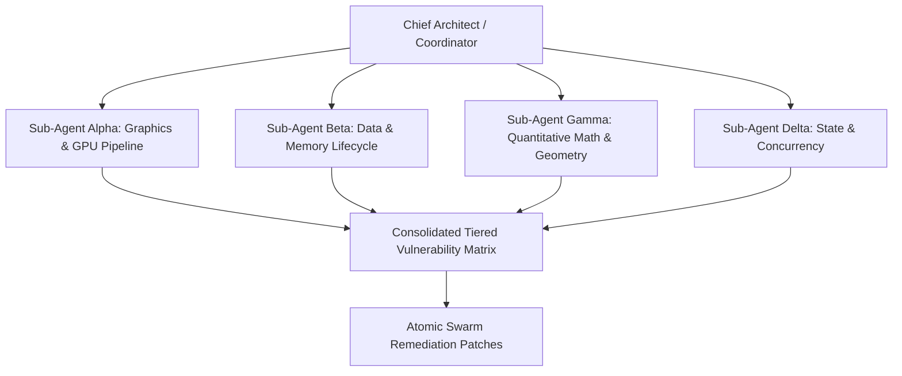

# Multi-Agent Architectural Auditing & Swarm Remediation Protocol

## 1. Executive Summary & Purpose
When architecting complex, high-performance systems (such as financial drafting desks, real-time trading engines, or scientific visualizers), single-agent audits frequently suffer from cognitive tunnel vision—focusing on visual layout while missing memory leaks, or fixing state management while overlooking mathematical drift.

This skill institutionalizes the **Multi-Persona Architectural Audit Protocol**, which deploys specialized autonomous sub-agents with strict domain boundaries, synthesizes findings into a unified **Tiered Vulnerability Matrix (P0 to P2)**, and executes atomic, sequential **Swarm Remediation Patches**.

---

## 2. Multi-Persona Specialization Matrix

When auditing an institutional codebase prior to production data ingestion or release, decompose the inspection into four dedicated agent personas:



### Domain Allocations:
1. **Sub-Agent Alpha (Graphics & GPU Pipeline)**:
   - **Canvas2D/WebGL Layer Decoupling**: Verifies isolation across background, data, rulers, and interactive reticles.
   - **Frustum Culling**: Confirms data virtualization bounds and off-by-one errors in binary search slicing.
   - **Hardware Acceleration**: Verifies browser engine flags (`--enable-gpu-rasterization`, `--ignore-gpu-blocklist`, `--disable-software-rasterizer`).
   - **Level-of-Detail (LOD)**: Audits draw-call inflation at extreme zoom-out levels (`scaledBase < 3.0px`).
   - **Path Sanitization**: Detects missing `ctx.beginPath()` calls that cause ghost trails across dirty-rect passes.

2. **Sub-Agent Beta (Data & Memory Lifecycle)**:
   - **Web Worker Offloading**: Validates background parsing of large CSV/Parquet streams without main-thread UI blockage.
   - **Resource Teardown**: Audits `ResizeObserver`, `matchMedia`, and DOM event listeners for strict unmount cleanups.
   - **Worker Race Conditions**: Guards against rapid consecutive uploads where out-of-order `FileReader` completions overwrite newer state.
   - **Data Sanitization**: Audits regex sanitization (`/[^0-9.-]+/g`) and strict `Number.isFinite()` validation to prevent `NaN`/`Infinity` poisoning.

3. **Sub-Agent Gamma (Quantitative Math & Geometry)**:
   - **Coordinate Transformations**: Audits continuous world-to-screen and screen-to-world linear projections.
   - **Grid Period Drift Compensation**: Resolves sub-pixel rounding errors in offscreen hardware tiling by calculating fractional scaling ratios:
     $$\text{scaleComp} = \frac{\text{exactTileW}}{\text{physicalTileW}} = \frac{\text{majorUnit} \times \text{zoom} \times \text{dpr}}{\text{Math.round}(\text{majorUnit} \times \text{zoom} \times \text{dpr})}$$
   - **Mathematical Boundary Guards**: Guards square root cycles and logarithmic conversions against negative roots ($x < 0$) or zero divisors ($v \le 0$).
   - **Isotropic Aspect-Ratio Sentinels**: Verifies 1:1 square geometric grid alignment across varying display DPIs.

4. **Sub-Agent Delta (State & Concurrency)**:
   - **Store Subscription Granularity**: Prevents whole-store selector subscriptions (`useGridState()`) that trigger 60–144Hz component re-render cascades.
   - **Effect Dependency Decoupling**: Replaces volatile callback dependencies in system observers with stable `useRef` delegation (`renderFnsRef`).
   - **Micro-Stuttering Elimination**: Replaces unmemoized $O(N)$ operations during mouse movement with atomic cached state updates.

---

## 3. Strict Rules of Engagement for the Audit Phase

1. **Absolute Read-Only Constraint**:
   Auditors are strictly forbidden from modifying source files, writing patches, or running builds during the audit turn. Premature edits create race conditions and invalidate peer agent evaluations.
2. **Deterministic Evidence Requirement**:
   Every reported finding must provide:
   - Exact file path and line number ranges.
   - Concrete failure mechanism (e.g. proof of mathematical drift or memory leak).
   - Blast radius (e.g. "collapses frame rate from 60 FPS to 5 FPS on 100k candles").
   - Drop-in remediation code snippet.
3. **P0 to P2 Classification Taxonomy**:
   - **P0 (Critical)**: Immediate crash, memory exhaustion, UI freeze, permanent visual corruption, or mathematical miscalculation.
   - **P1 (High)**: Edge-case race conditions, unmemoized $O(N)$ operations, or fragile fallback mechanisms.
   - **P2 (Medium / Low)**: Redundant type conversions, code duplication, or non-breaking UI polish.

---

## 4. Swarm Remediation Workflow

Once the Chief Architect reviews and synthesizes the Tiered Audit Report, execution transitions into the **Swarm Remediation Phase**:

```
[Master Audit Report]
       │
       ▼
[Atomic Swarm Patch 1] ──> [Build Pipeline: npm run build + PyInstaller] ──> [Git Commit & Push]
       │
       ▼
[Atomic Swarm Patch 2] ──> [Build Pipeline: npm run build + PyInstaller] ──> [Git Commit & Push]
       │
       ▼
[Atomic Swarm Patch 3] ──> [Build Pipeline: npm run build + PyInstaller] ──> [Git Commit & Push]
       │
       ▼
[Multi-Project Cross-Repository Synchronization]
```

### Remediation Best Practices:
1. **One Mutation per Patch**:
   Never bundle multiple architectural fixes into a single commit. Isolating fixes ensures that if a regression occurs, `git bisect` immediately identifies the offending commit.
2. **Automated Verification**:
   Execute `python build_pipeline.py` after each patch to guarantee TypeScript compilation, bundle tree-shaking, and single-file Windows executable packaging succeed without warnings.
3. **Autonomous Persistence**:
   Immediately stage, commit with a semantic message (`fix(...)`, `feat(...)`), push to `origin/main`, and trigger the cross-project GitHub replication script.
